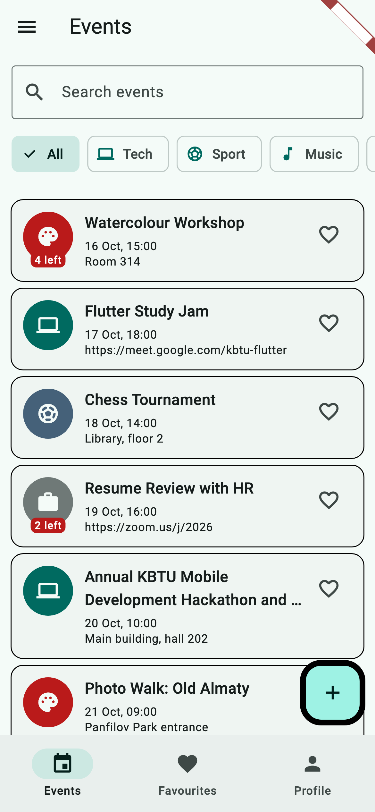
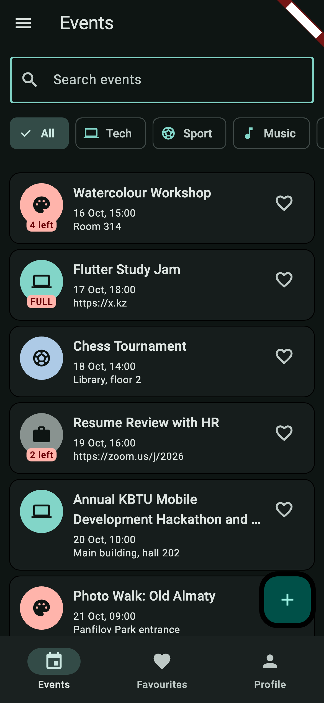
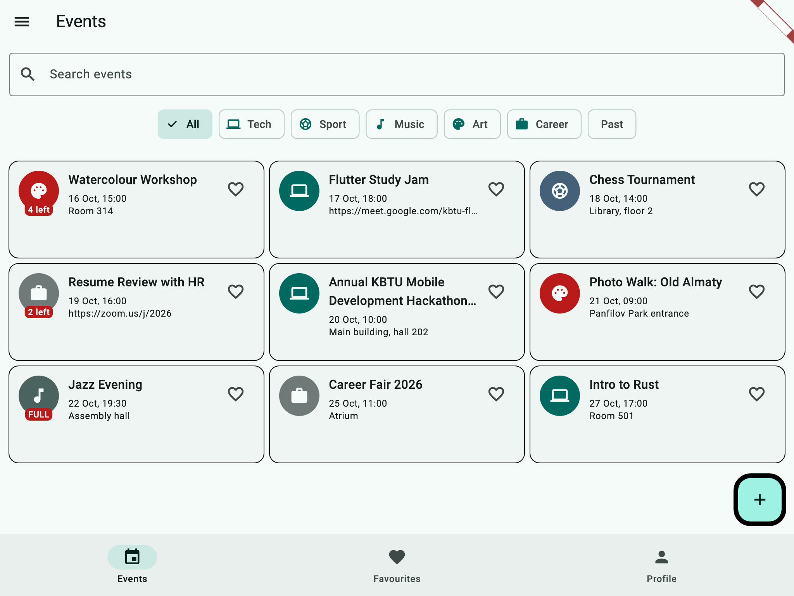

# kbtu_flutter

Weekly Flutter tasks live in `lib/weekNN/`. Lab 1 lives in `lib/lab1/`.

## Lab 1: Campus Events

Students browse campus events, register for them and keep favourites. Each event has a title, a category, a start time, a place (or a link when it is online), a capacity and the list of attendees. All data is in memory.

Run it with:

```
flutter run -t lib/lab1/main.dart
```

| Phone, light | Phone, dark | Tablet, grid |
| --- | --- | --- |
|  |  |  |

### Decisions

The event list and the profile live in the State of the shell, and the tabs only get them as constructor parameters and send changes back through callbacks. The detail screen takes callbacks because it changes an event that the shell owns, and it has to tell the shell right away so the list is up to date when we go back. The form returns a value through pop instead, because it only produces one new or edited event and the caller decides what to do with it. The grid uses LayoutBuilder because it depends on the width the list actually gets, not on the size of the whole screen. PopScope compares the current values of the form with the values it opened with, so going back from an unchanged form does not ask anything. With week 9's tools I would move the list out of the shell into a shared state object and save it to storage so it survives a restart.
